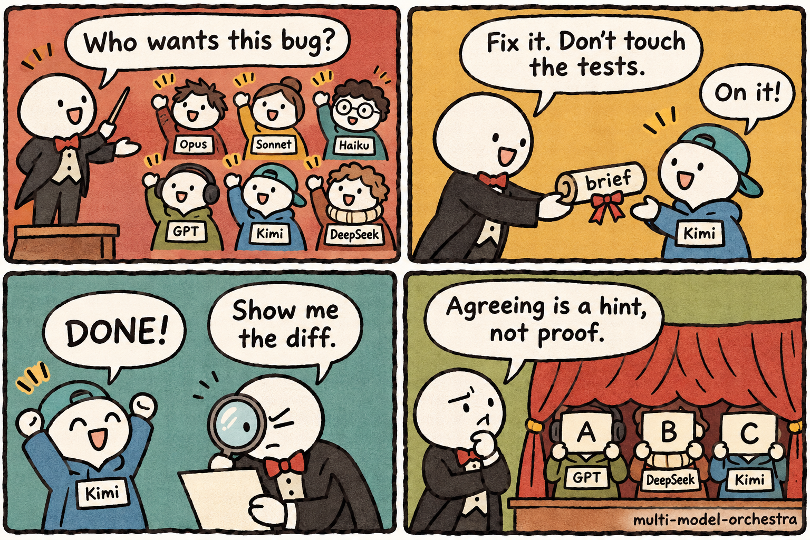
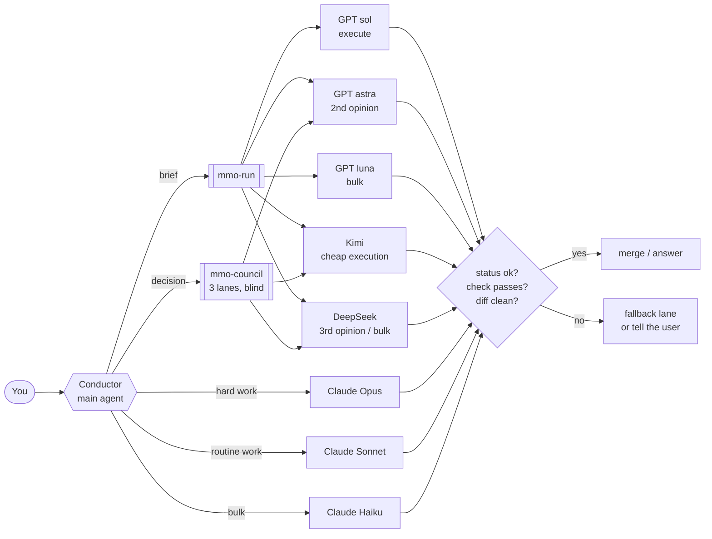

# multi-model-orchestra

<p align="center"></p>

Skills that let a coding agent (Claude Code, or anything that reads `SKILL.md` files) hand work to
**Claude Opus / Sonnet / Haiku, OpenAI GPT (Codex CLI), Kimi and DeepSeek**, and check the answer
before using it.

The main agent is the conductor: it decides who plays which part, writes the brief, and reviews what comes back.
The skills give it a routing policy, and the scripts make the dangerous parts boring:
one runner for every provider, hard status codes, a worktree guard for anything that writes,
an offline preflight, and a blind council for decisions.



## What is inside

| Skill | What it does |
|---|---|
| [`orchestra`](skills/orchestra/SKILL.md) | The policy: when not to delegate, who gets which job, brief rules, gates, fallbacks. Holds the scripts and brief templates. |
| [`council`](skills/council/SKILL.md) | Same question to three model families, read-only, answers shuffled to letters before you judge them. |
| [`chatgpt-lane`](skills/chatgpt-lane/SKILL.md) | GPT through the Codex CLI: gpt-6.1-sol, gpt-6-astra, gpt-6-luna. |
| [`kimi-lane`](skills/kimi-lane/SKILL.md) | Kimi through the Kimi Code CLI. |
| [`deepseek-lane`](skills/deepseek-lane/SKILL.md) | DeepSeek v4-pro and flash through the Kimi Code CLI. |

Claude tiers run as the host agent's own sub-agents (`Agent` tool with an explicit model), so they need no script.

## Install

Needs bash, git, `timeout` and Python 3. Each lane needs its own CLI, signed in: `codex` for GPT, `kimi` for Kimi and DeepSeek.
On Windows, use Git Bash.

```bash
git clone https://github.com/yatuk/multi-model-orchestra
cd multi-model-orchestra
./install.sh --link          # into ~/.claude/skills; --dir PATH for a project
~/.claude/skills/orchestra/scripts/mmo-preflight
```

`mmo-preflight` never calls a model. It tells you which lanes exist on this machine, so the conductor routes around the missing ones.

## The runner

```bash
mmo-run <codex|kimi|deepseek|claude> --brief FILE --out FILE
        [-m MODEL] [-e EFFORT] [--mode ro|rw] [-C DIR] [-t SECONDS] [--allow-main]
```

Every lane, whatever the vendor, ends the same way: an output file whose first line is

```
<!-- mmo provider=kimi model=kimi-code/k3.1-pro mode=rw status=ok exit=0 seconds=36 -->
```

| Exit | Status | Meaning |
|---|---|---|
| 0 | ok | An answer is in the file. Still check it. |
| 3 | failed | The CLI failed; the last stderr lines are in the file. |
| 4 | timeout | Killed after `-t` seconds. |
| 5 | empty | The CLI exited 0 but gave no final answer. |
| 6 | limit | Quota, balance, rate limit or plan. Use the fallback lane. |
| 7 | auth | The CLI needs a fresh sign-in. Tell the user. |

### Safety model

- **Writes only in a worktree.** `--mode rw` refuses to run unless `-C` is a linked git worktree. A lane cannot edit your main checkout by accident.
- **Read-only means read-only.** Codex gets its read-only sandbox. Kimi Code has none and edits files in print mode even when asked not to, so read-only Kimi and DeepSeek lanes run in a throwaway detached worktree; anything they write is thrown away and flagged `ro_violation=yes`.
- **A failed lane is not an answer.** No falling through to "the model said nothing, so it's fine". The council records a failed lane as *not an answer, not a vote*.
- **No stdin, always a timeout.** Every CLI runs with `</dev/null` under `timeout -k 10`, so nothing hangs on a prompt.
- **Briefs leave your machine.** The skills say it plainly: never put secrets or personal data in a brief.

## Benchmark

`bench/run.sh` runs three tasks on every lane in parallel and grades them with no model in the loop:

| Task | Mode | Graded by |
|---|---|---|
| **bugfix**: fix a duration parser so it follows five written rules | rw, own worktree | visible tests must pass and stay unedited; score = share of 6 hidden tests passed |
| **reasoning**: two Python trace questions and one counting question, no running code | ro | exact match against answers computed by running the code |
| **bulk**: label 60 log lines CRITICAL / ERROR / WARN / INFO by first-match rules with traps (`panicked`, `errorless`, 404) | ro | accuracy against gold labels generated from the same rules |

Results from 2026-11-11 (one run per cell; full answers and diffs in [`bench/results/2026-11-11`](bench/results/2026-11-11)):

| Lane | bugfix (hidden) | reasoning | bulk | wall time (s) b / r / k |
|---|---|---|---|---|
| GPT gpt-6.1-sol | 6/6 | 3/3 | 60/60 | 79 / 12 / 15 |
| GPT gpt-6-astra | 6/6 | 3/3 | 60/60 | 45 / 14 / 17 |
| GPT gpt-6-luna (effort low) | visible tests fail | 2/3 | 56/60 | 38 / 11 / 13 |
| Kimi k3.1-pro | 6/6 | 3/3 | 60/60 | 36 / 11 / 16 |
| Kimi k3.1-pro-highspeed | not on this plan (`limit`) |: |: |: |
| DeepSeek v4-pro | 6/6 | 3/3 | 60/60 | 49 / 10 / 17 |
| DeepSeek flash | 6/6 | 3/3 | 60/60 | 14 / 4 / 9 |
| Claude Opus (sub-agent) | 6/6 | 3/3 | 60/60 | n/a |
| Claude Sonnet (sub-agent) | 6/6 | 3/3 | 60/60 | n/a |
| Claude Haiku (sub-agent) | 6/6 | 3/3 | 60/60 | n/a |

How to read it:
- **This is a smoke test, not a leaderboard.** One run per cell, small tasks. Most strong lanes max it out. It tells you which lanes work end to end on your machine and which are not good enough for a job, not which model is "best".
- **The cheap tier is where it bites.** gpt-6-luna at low effort broke the visible tests and mislabeled 4 trap lines, so bulk work on luna needs a sample check. DeepSeek flash was fastest and clean here.
- **The benchmark found two runner bugs before you would have.** Kimi Code rejects `-p` with `--auto` (write lanes failed in 1 s), and the answer extractor crashed on a non-ASCII arrow on a Windows console code page, which turned a correct DeepSeek fix into `empty`. Both are fixed and the lanes re-run; the table shows the re-runs. That is the point of hard status gates: the failure showed up as a status, not as a silent wrong answer.
- Claude tiers ran as Claude Code sub-agents, so there are no comparable wall times.

Run it on your own stack:

```bash
bench/run.sh                                    # default lanes
bench/run.sh codex:gpt-6.1-sol:high kimi:kimi-code/k3.1-pro
```

## How this compares

Other projects solve parts of this well. This repo borrows no code from them; the table is from their public READMEs as of November 2026.

| Project | Best at | What this repo adds |
|---|---|---|
| jarrodwatts/claude-delegator (archived) | Expert personas over Codex/GPT, advisory vs. implementation modes | Kimi and DeepSeek lanes, Claude tier routing, one status contract for all CLIs |
| hkasahar/claude-code-skills | File-based delegation with a checkable header, offline preflight | Same ideas across four CLIs, plus worktree-only writes and a benchmark |
| k1064190/claude-code-gemini-cli-skills | Strict timeouts, exit-code gates, pinned models for Gemini | The same discipline for GPT, Kimi and DeepSeek |
| rachittshah/llmcouncil | Many council modes (vote, debate, critique), anonymized peer review | A small blind council that runs on CLIs you already pay for, with failed lanes excluded |
| PAL MCP (consensus) | Stance-steered consensus through one MCP server | No server: plain scripts and skills, enforced read-only for every lane |

None of the above covered Kimi or DeepSeek through their coding CLIs when this was written.

## Layout

```
skills/
  orchestra/   SKILL.md, scripts/ (mmo-run, mmo-council, mmo-preflight, mmo_extract.py), templates/
  council/     chatgpt-lane/  kimi-lane/  deepseek-lane/
bench/         run.sh, grade.py, tasks/, results/
```

## License

MIT. The README illustration was generated with gpt-image-2 through the Codex CLI.
