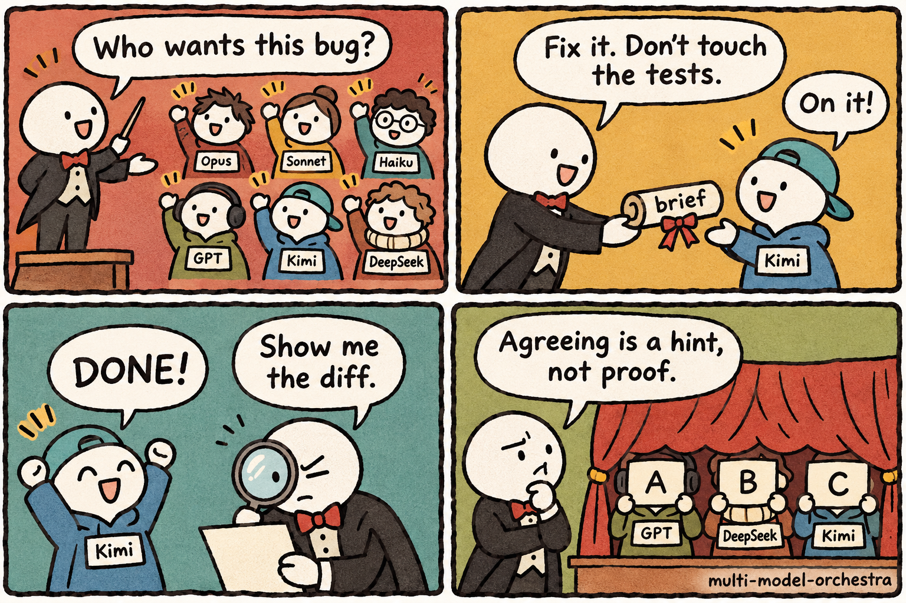

<p align="center">
  
</p>

<h1 align="center">multi-model-orchestra</h1>

<p align="center"><sub><a href="../README.md">English</a> · <a href="README_TR.md">Türkçe</a> · <a href="README_UK.md">Українська</a> · <a href="README_ZH.md">简体中文</a> · <a href="README_ZH-TW.md">繁體中文</a> · <a href="README_DE.md">Deutsch</a> · <a href="README_FR.md">Français</a> · <a href="README_ES.md">Español</a> · <a href="README_JA.md">日本語</a> · <a href="README_KO.md">한국어</a> · <a href="README_AZ.md">Azərbaycanca</a> · <a href="README_UZ.md">Oʻzbekcha</a> · <a href="README_KK.md">Қазақша</a> · <a href="README_KY.md">Кыргызча</a> · <a href="README_TK.md">Türkmençe</a> · <a href="README_CRH.md">Qırımtatarca</a> · ئۇيغۇرچە · <a href="README_PT.md">Português</a> · <a href="README_VI.md">Tiếng Việt</a></sub></p>

<div dir="rtl">

<p align="center"><b>قىممەت بىر مودېل دىرىژورلۇق قىلسۇن، ئەرزانراق مودېللار چالسۇن، ھەر بىر جاۋاب ئىشلىتىلىشتىن بۇرۇن تەكشۈرۈلسۇن.</b><br>
Claude Code (ياكى <code>SKILL.md</code> ھۆججەتلىرىنى ئوقۇيدىغان ھەر قانداق ئاگېنت) ئۈچۈن، ئىشنى Claude Opus، Sonnet ۋە Haiku، OpenAI GPT، Kimi ۋە DeepSeek مودېللىرىغا تاپشۇرىدىغان ماھارەتلەر (skills).<br>
ئاساسىي ئاگېنت پىلانلايدۇ، تاپشۇرۇق خېتى (brief) يازىدۇ ۋە تەكشۈرىدۇ؛ ئىشنى باشقا مودېللار قىلىدۇ، ئۇلار قايتۇرغان ھېچنەرسىگە تەكشۈرۈشتىن ئۆتمىگۈچە ئىشەنچ قىلىنمايدۇ.</p>

<p align="center">
  <a href="../LICENSE"></a>
  
  
  <a href="https://github.com/yatuk/multi-model-orchestra"></a>
</p>

<p align="center"><b><a href="#تېز-باشلاش">ئورنىتىش</a></b> · <a href="otomode.md">otomode</a> · <a href="how-it-works.md#council">Council</a> · <a href="benchmark.md">Benchmark</a> · <a href="faq.md">سوئال-جاۋاب</a></p>

<p align="center">
  
  <br>
  <sub>دىرىژور ۋەزىپىلەرنى تەقسىم قىلىدۇ، diff نى سورايدۇ، جاۋاب باھالاشنى تەلەپ قىلغاندا نامسىز كېڭەش (council) چاقىرىدۇ.</sub>
</p>

<table>
  <tr>
    <td width="25%" valign="top">
      <b>يۆنىلىش بېكىتىش</b><br>
      ھەر بىر ئىش قىيىنلىقىغا قاراپ، ئۆز تەكشۈرۈشىدىن ئۆتەلەيدىغان ئەڭ ئەرزان دەرىجىگە ئەۋەتىلىدۇ. بىر يول (lane) پەرەز بىلەن ئەمەس، پەقەت تەكشۈرۈشتىن ئۆتەلمىگەندىن كېيىنلا يۇقىرى دەرىجىگە ئۆرلەيدۇ.
    </td>
    <td width="25%" valign="top">
      <b>تاپشۇرۇق</b><br>
      ھەر بىر دەرىجە ئۆزىگە ئەڭ ماس كېلىدىغان تاپشۇرۇقنى ئالىدۇ: Opus قا مەقسەت ۋە چەكلىمىلەر، ئەرزانراق يوللارغا نومۇرلانغان قەدەملەر ۋە ئېنىق ھۆججەتلەر. يول پەقەت تاپشۇرۇقنىلا كۆرىدۇ، شۇڭا ئۇ ناتونۇش ئادەم ئۈچۈن يېزىلىدۇ.
    </td>
    <td width="25%" valign="top">
      <b>ئىجرا قىلىش</b><br>
      <code>mmo-run</code> بارلىق تەمىنلىگۈچىلەر ئۈچۈن بىردىنبىر ئىجرا قىلغۇچ (runner): قاتتىق ھالەت كودلىرى بار، ھەر بىر چاقىرىشنىڭ ۋاقىت چېكى بار. يازىدىغان يوللار پەقەت git worktree ئىچىدىلا ئىشلەيدۇ، ھەرگىز ئاساسىي checkout ىڭىزدا ئەمەس.
    </td>
    <td width="25%" valign="top">
      <b>تەكشۈرۈش</b><br>
      تەكشۈرۈشنى دىرىژور ئۆزى ئىجرا قىلىدۇ ۋە پۈتۈن diff نى ئوقۇيدۇ. يولنىڭ «تامام» دېيىشى نەتىجە ئەمەس، پەقەت بىر دەۋا.
    </td>
  </tr>
</table>

## ھەقىقىي سانلار

| نېمە | نەتىجە | تەپسىلاتى |
|---|---|---|
| <!-- AB-RESULTS --> A/B: orchestra ماھارىتى بىلەن ئاددىي "use subagents" سېلىشتۇرمىسى (`claude-fable-5-2`، ھەر تەرەپكە 2 قېتىم ئىجرا) | سۈپەت ئوخشاش: تۆت قېتىملىق ئىجرانىڭ ھەممىسى 36/36 يوشۇرۇن سىناق، كۆرۈنىدىغان سىناقلار ئۆزگەرمىگەن (ۋەزىپە توپلىمى سۈپەتنى ئايرىشقا بەك ئاسان) | [benchmark.md](benchmark.md#ab-test-orchestra-skill-vs-use-subagents-2026-11-21) |
| <!-- AB-RESULTS --> A/B ھەر قېتىملىق ئىجرا تەننەرخى | ماھارەت ئوتتۇرىچە $1.88، يەنە بىر تەرەپ $3.21، تەخمىنەن 40% ئەرزان، دائىرىلەر بىر-بىرىنى قاپلىمايدۇ. تېجەش ياردەمچى ئاگېنتلارنىڭ Fable غا ۋارىسلىق قىلماي، Sonnet تا ئىشلىشىدىن كېلىدۇ. سۈرئەتتە ئۈستۈنلۈك يوق (3.2 گە قارشى 3.5 مىنۇت) | [RESULTS.md](../bench/ab/results/2026-11-21/RESULTS.md) |
| <!-- AB-RESULTS --> A/B چەكلىمىلىرى | بىر قۇرلۇق "use Sonnet subagents" سورىقى سىنالمىدى، ئۇ تېجەشنىڭ كۆپ قىسمىنى قولغا كەلتۈرۈشى مۇمكىن. `total_cost_usd` پىلان ئىشلىتىش مىقدارى ئەمەس، باھا جەدۋىلىدىكى باھا بويىچە ۋاسىتىلىك كۆرسەتكۈچ | [faq.md](faq.md#why-not-just-tell-the-model-to-use-subagents) |
| يوللار benchmark ى، 2026-11-21 (يوشۇرۇن سىناقلىق خاتالىق تۈزىتىش، ئېنىق جاۋابلىق پىكىر يۈرگۈزۈش، 60 قۇرلۇق تۈركۈملەپ بەلگە قويۇش) | Kimi k3.1-pro، DeepSeek v4-pro، DeepSeek flash ۋە gpt-5.6-terra: 6/6, 3/3, 60/60. gpt-6-luna: 6/6, 0/3, 58/60. gpt-6.1-sol ۋە gpt-6-astra: ~6/6, ~3/3, ~60/60 (مۆلچەر: ئۇ پىلاندا تەمىنلەنمەيدۇ، نومۇرلار 2026-11-11 دىكى ئىجرادىن ئېلىندى) | [benchmark.md](benchmark.md) |
| otomode، بىر قېتىملىق 5 سائەتلىك نازارەتسىز ئىجرا | 13 ۋەزىپە، ھەر بىرىگە بىر commit؛ ھەپتىلىك چەك 25% تىن 31% كە چىقتى؛ 6 ئىجازەت سورىقى رەت قىلىنىپ خاتىرىگە ئېلىندى. بۇ بىر قېتىملىق ئىجرا، benchmark ئەمەس | [otomode.md](otomode.md#one-real-run) |

> [!WARNING]
> تاپشۇرۇقلار كومپيۇتېرىڭىزدىن چىقىپ كېتىدۇ: ھەر بىر يول ئۆز تاپشۇرۇقىنى شۇ مودېلنىڭ تەمىنلىگۈچىسىگە ئەۋەتىدۇ. تاپشۇرۇققا ھەرگىز مەخپىيەتلىك،
> token ياكى شەخسىي ئۇچۇر قويماڭ. otomode نىڭ hook ى ئىجازەت سوراقلىرىنى رەت قىلىدۇ ۋە ئۆچۈرۈش، deploy، push ۋە ئەۋەتىش بۇيرۇقلىرىنى توسىدۇ،
> لېكىن ئۇ پەقەت قېلىپ ماسلاشتۇرىدۇ: ئۇ sandbox ئەمەس، پەقەت بىر قوغداش رېشاتكىسى.

## تېز باشلاش

بۇنى ئاگېنتىڭىزغا چاپلاڭ، ماھارەتلەرنى ئۇ ئورناتسۇن:

</div>

```text
Install multi-model-orchestra: clone https://github.com/yatuk/multi-model-orchestra,
run ./install.sh --link in it, then run ~/.claude/skills/orchestra/scripts/mmo-preflight
and tell me which lanes are ready.
```

<div dir="rtl">

ياكى ئۆزىڭىز ئورنىتىڭ. bash، git، `timeout` ۋە Python 3 كېرەك؛ Windows تا Git Bash ئىشلىتىڭ.

</div>

```bash
git clone https://github.com/yatuk/multi-model-orchestra
cd multi-model-orchestra
./install.sh --link          # into ~/.claude/skills; --dir PATH for a project
~/.claude/skills/orchestra/scripts/mmo-preflight
```

<div dir="rtl">

`mmo-preflight` ھەرگىز مودېل چاقىرمايدۇ. ئۇ بۇ كومپيۇتېردا قايسى يوللارنىڭ بارلىقىنى ئېيتىپ بېرىدۇ، شۇڭا دىرىژور يوق بولغانلىرىنى ئايلىنىپ ئۆتىدۇ.
otomode ئۈچۈن، ئۇنىڭ hook ىنى تىزىملىتىش ئۈچۈن بىر قېتىم `python ~/.claude/skills/otomode/scripts/otomode.py install` نى ئىجرا قىلىڭ.

ئاندىن، مەسىلەن، مۇنداق سوراڭ:

- "`internal/auth` ئىچىدىكى مەغلۇپ بولغان سىناقلارنى تۈزەت. orchestra ماھارىتىگە ئەمەل قىل."
- "بىرلەشتۈرۈشتىن بۇرۇن بۇ كۆچۈرۈش (migration) پىلانى ھەققىدە GPT دىن ئىككىنچى پىكىر ئال."
- "كېڭەشتىن سورا: بۇ مۇلازىمەتنى بۆلەمدۇق ياكى بىر جەرياننى ساقلامدۇق؟"
- "otomode 6h: مۇشۇ تۆت ۋەزىپە، ھەر بىرى `go test ./...` بىلەن تەكشۈرۈلسۇن."

## قايسى قوراللار بىلەن ئىشلەيدۇ

| قورال | نېمە ئۈچۈن | كېرەكلىكلەر |
|---|---|---|
| Claude Code | ماھارەتلەر، ھەمدە ياردەمچى ئاگېنت سۈپىتىدە Claude Opus / Sonnet / Haiku دەرىجىلىرى | ماھارەتلەر `~/.claude/skills` (ياكى بىر تۈرنىڭ `.claude/skills`) ئىچىگە ئورنىتىلغان؛ باشقا ھېچنېمە كېرەك ئەمەس |
| Codex CLI | GPT يوللىرى | PATH تا `codex`، ChatGPT بىلەن كىرگەن |
| Kimi Code CLI | Kimi ۋە DeepSeek يوللىرى | PATH تا `kimi`، كىرگەن؛ DeepSeek ئۈچۈن Kimi Code نىڭ `config.toml` ھۆججىتىدە بىر `deepseek/*` مودېلى |

GPT مودېل id لىرى: بەزى ChatGPT پىلانلىرىدا Codex CLI ھازىر باشقا id لارنى تەمىنلەيدۇ (مەسىلەن gpt-5.6-terra ياكى gpt-6-luna)
ۋە باشقىلىرىنى رەت قىلىدۇ. سۈكۈتتىكى قىممەتلەر ماھارەت ھۆججەتلىرىدە يېزىلغان؛ ئىشنى ئۇ يەرگە يۆنەلتىشتىن بۇرۇن پىلانىڭىز قوبۇل قىلىدىغان
id لارنى قىسقىچە سىناپ بېقىڭ (CLI لارنى كۆرۈش ئۈچۈن `mmo-preflight`، ئاندىن ھەر بىر id ئۈچۈن بىر قۇرلۇق `mmo-run` تاپشۇرۇقى). قاراڭ: [Model ids](how-it-works.md#model-ids).

## تېخىمۇ كۆپ

تۆۋەندىكى ھۆججەتلەر ئىنگلىزچە (ئەڭ ئاخىرقىسىدىن باشقا).

- [How it works](how-it-works.md): يۆنىلىش جەدۋىلى، ئىجرا قىلغۇچ، ھالەت كودلىرى، بىخەتەرلىك مودېلى، كېڭەش (council).
- [otomode](otomode.md): سىز يوق ۋاقىتتىكى نازارەتسىز ئىجرالار.
- [Benchmark](benchmark.md): يوللار benchmark ى ۋە A/B سىنىقى، ئىككىلىسىنى قانداق ئىجرا قىلىش ئۇسۇلى بىلەن.
- [FAQ](faq.md): ئوخشاش تۈرلەر بىلەن سېلىشتۇرۇشنىمۇ ئۆز ئىچىگە ئالىدۇ.
- تۈركچە ماقالە: [Fable 5.2 ile orkestra ve otomode](fable-orkestra-ve-otomode.md)، قىممەت ئاساسىي سىكىل مودېلىنى دىرىژور قىلىپ ئىشلىتىش ۋە ئۇنى نازارەتسىز ئىشلەشكە قويۇپ بېرىش توغرىسىدا.

## قۇرۇلما

</div>

```
skills/
  orchestra/   SKILL.md, scripts/ (mmo-run, mmo-council, mmo-preflight, mmo_extract.py), templates/
  council/     chatgpt-lane/  kimi-lane/  deepseek-lane/
  otomode/     SKILL.md, scripts/ (otomode.py: switch, hook, usage gate; statusline.py)
bench/         run.sh, grade.py, tasks/, results/; ab/ for the A/B test
docs/          how-it-works, otomode, benchmark, faq, translations
```

<div dir="rtl">

## ئىجازەتنامە

MIT، قاراڭ: [LICENSE](../LICENSE). README رەسىمى Codex CLI ئارقىلىق gpt-image-2 بىلەن ھاسىل قىلىندى.

</div>
