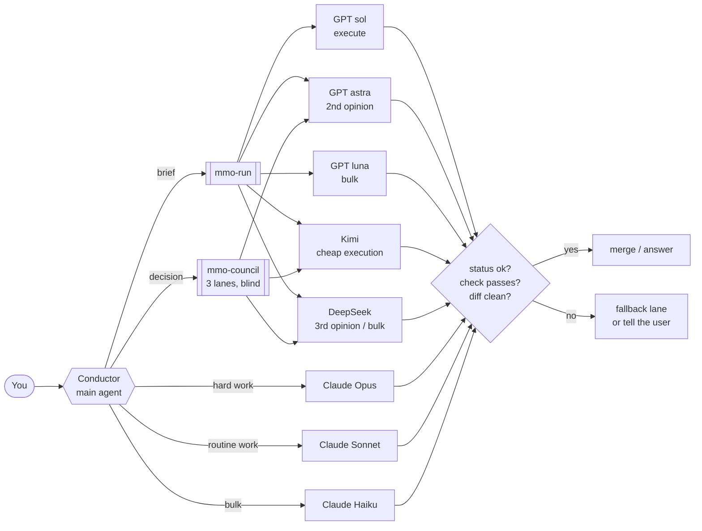

# How it works

[Back to the README](../README.md)

The main agent is the conductor: it decides who plays which part, writes the brief, and reviews what comes back.
The skills give it a routing policy, and the scripts make the dangerous parts boring:
one runner for every provider, hard status codes, a worktree guard for anything that writes,
an offline preflight, and a blind council for decisions.



## The skills

| Skill | What it does |
|---|---|
| [`orchestra`](../skills/orchestra/SKILL.md) | The policy: when not to delegate, who gets which job, brief rules, gates, fallbacks. Holds the scripts and brief templates. |
| [`council`](../skills/council/SKILL.md) | Same question to three model families, read-only, answers shuffled to letters before you judge them. |
| [`chatgpt-lane`](../skills/chatgpt-lane/SKILL.md) | GPT through the Codex CLI: gpt-6.1-sol, gpt-6-astra, gpt-6-luna. |
| [`kimi-lane`](../skills/kimi-lane/SKILL.md) | Kimi through the Kimi Code CLI. |
| [`deepseek-lane`](../skills/deepseek-lane/SKILL.md) | DeepSeek v4-pro and flash through the Kimi Code CLI. |
| [`otomode`](../skills/otomode/SKILL.md) | Unattended runs while you are away. See [otomode.md](otomode.md). |

Claude tiers run as the host agent's own sub-agents (`Agent` tool with an explicit model), so they need no script.

## Routing

Pick the cheapest lane that will pass the check. Move up only when a lane fails the check, not on a hunch.
This is the table from [`skills/orchestra/SKILL.md`](../skills/orchestra/SKILL.md):

| Job | First choice | Brief style | Fallback |
|---|---|---|---|
| Hard design, tricky bug, unfamiliar code | Claude Opus (sub-agent) | Goal + constraints, let it plan | gpt-6.1-sol, effort high |
| Routine feature, clear bug, refactor with tests | Claude Sonnet (sub-agent) or gpt-6.1-sol | Steps, files, done-check | Kimi k3.1-pro |
| Well-specified execution on the GPT side | gpt-6.1-sol | Numbered steps, exact files, exact check | Kimi, DeepSeek v4-pro |
| Second opinion, "what are we missing" | gpt-6-astra (read-only) | The question + the evidence, ask for disagreement | DeepSeek v4-pro |
| Third opinion from another family | DeepSeek v4-pro (read-only) | Same as above | Kimi |
| Cheap execution of easy, testable work | Kimi k3.1-pro or DeepSeek v4-pro | Very explicit steps | gpt-6-luna |
| Bulk mechanical work (labeling, renames, data cleanup) | Claude Haiku, gpt-6-luna or deepseek-flash | Rules + format + examples | Next bulk lane |
| A decision with no single right answer | Council (3 lanes, blind) | Same question to all | Ask the user |

Not everything should be delegated. The conductor does the job itself when it takes fewer steps than the brief,
needs conversation context that does not fit on a page, touches secrets or anything irreversible,
or the user is waiting on a quick answer.

### Model ids

The skill files name the default model ids (gpt-6.1-sol, gpt-6-astra and gpt-6-luna in
[`chatgpt-lane`](../skills/chatgpt-lane/SKILL.md)). On some ChatGPT plans the Codex CLI now serves different
model ids and rejects others. On the plan used for the [2026-11-21 benchmark](benchmark.md), `gpt-6.1-sol`,
`gpt-6-astra` and `gpt-5.6-sol` came back as HTTP 400 `model_not_found`, while `gpt-5.6-terra`, `gpt-6-luna`
and `gpt-5.6-luna` answered.

Smoke-test the ids before you route real work to a lane. `mmo-preflight` is offline and only tells you which
CLIs are installed; then send a one-line brief through `mmo-run` with each `-m` you plan to use. A rejected id
shows up as a non-`ok` status, not as a silent answer.

## The runner

```bash
mmo-run <codex|kimi|deepseek|claude> --brief FILE --out FILE
        [-m MODEL] [-e EFFORT] [--mode ro|rw] [-C DIR] [-t SECONDS] [--allow-main]
```

Every lane, whatever the vendor, ends the same way: an output file whose first line is

```
<!-- mmo provider=kimi model=kimi-code/k3.1-pro mode=rw status=ok exit=0 seconds=36 -->
```

Examples:

```bash
scripts/mmo-preflight                       # offline: which lanes are installed
scripts/mmo-run codex   -m gpt-6.1-sol -e high --mode rw -C ../wt-auth --brief brief.md --out out/auth.md
scripts/mmo-run deepseek -m deepseek/deepseek-v4-pro --mode ro --brief q.md --out out/ds.md
```

### Status codes

| Exit | Status | Meaning |
|---|---|---|
| 0 | ok | An answer is in the file. Still check it. |
| 2 | usage | Wrong arguments to `mmo-run`. |
| 3 | failed | The CLI failed; the last stderr lines are in the file. |
| 4 | timeout | Killed after `-t` seconds. |
| 5 | empty | The CLI exited 0 but gave no final answer. |
| 6 | limit | Quota, balance, rate limit or plan. Use the fallback lane. |
| 7 | auth | The CLI needs a fresh sign-in. Tell the user. |
| 8 | model | The model id was rejected (`model_not_found`). Switch to an id that answers; waiting will not help. |

## Safety model

- **Writes only in a worktree.** `--mode rw` refuses to run unless `-C` is a linked git worktree. A lane cannot edit your main checkout by accident.
- **Read-only means read-only.** Codex gets its read-only sandbox. Kimi Code has none and edits files in print mode even when asked not to, so read-only Kimi and DeepSeek lanes run in a throwaway detached worktree; anything they write is thrown away and flagged `ro_violation=yes`.
- **A failed lane is not an answer.** No falling through to "the model said nothing, so it's fine". The council records a failed lane as *not an answer, not a vote*.
- **No stdin, always a timeout.** Every CLI runs with `</dev/null` under `timeout -k 10`, so nothing hangs on a prompt.
- **Briefs leave your machine.** The skills say it plainly: never put secrets or personal data in a brief.

## Gates before an answer is used

1. The status header says `ok`. Anything else is not an answer.
2. The lane's own check passed, and the conductor re-ran it itself. A lane saying DONE proves nothing.
3. For writing lanes: the whole diff is read. Edits outside the allowed files, deleted or weakened tests, new dependencies and silenced warnings are rejected.
4. For opinions: arguments are weighed, not votes. Two models agreeing is a hint, not proof.
5. Lanes are merged one at a time; the full test suite runs once after the last merge.

## Council

For decisions where reasonable models disagree, the [`council`](../skills/council/SKILL.md) skill sends the
same question to three lanes from different families (GPT, Kimi and DeepSeek by default), read-only and in parallel.

```bash
../orchestra/scripts/mmo-council --question q.md --outdir council/ -C <repo>
```

The answers come back as `answer-A.md`, `answer-B.md`, ... with the letters shuffled; you read them before you
open `key.txt`, so you judge the reasoning and not the brand. A lane marked FAILED in `status.txt` is not an
answer and not a vote. If fewer than two lanes answered, it is not called a council.
